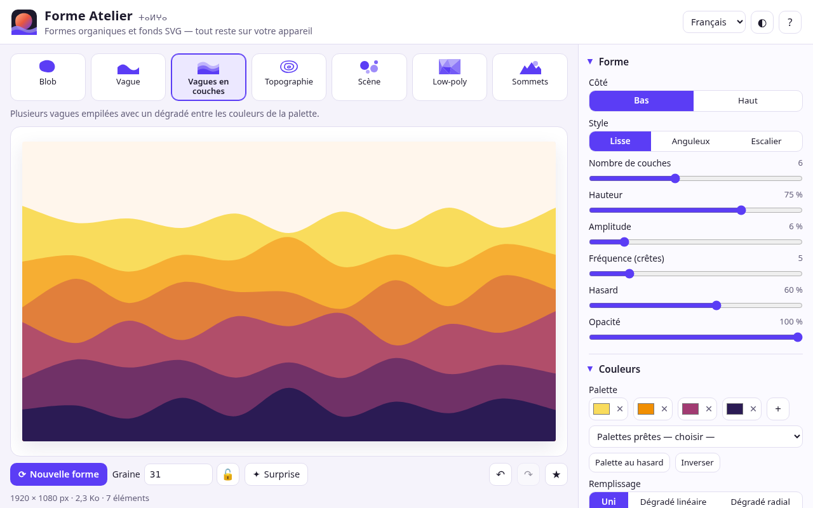
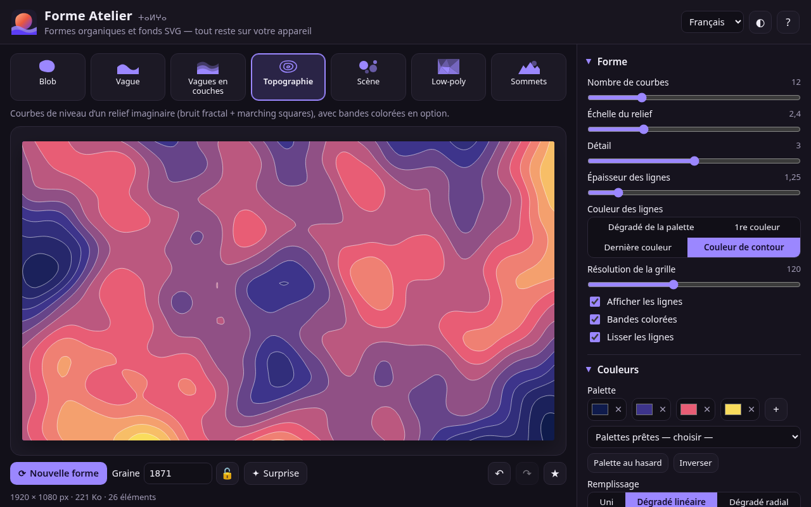
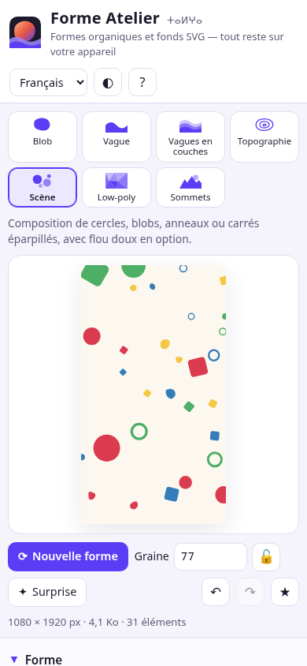

# Forme Atelier ⵜⴰⵍⵖⴰ

**Générateur libre et gratuit de formes organiques et de fonds SVG, directement dans le navigateur.**
Blobs, vagues, vagues en couches, courbes topographiques, scènes de formes éparpillées, low-poly et sommets —
avec une graine aléatoire reproductible, une palette personnalisable et des exports SVG, PNG, CSS et JSON.

👉 **Démo : https://salimadour31-boop.github.io/forme-atelier/**

## Pourquoi ?

Les fonds organiques (blobs, vagues, lignes de relief…) sont partout dans le design web, les affiches et les réseaux
sociaux. Forme Atelier les génère en quelques clics, en **vecteur propre** prêt pour Illustrator, Inkscape, Figma ou
le code d’un site — sans compte, sans abonnement, sans rien envoyer sur Internet.

## Fonctionnalités

### 7 générateurs
| Générateur | Réglages |
|---|---|
| **Blob** | complexité (nombre de points), contraste / hasard, taille, douceur des courbes (Catmull-Rom → Bézier), anneaux concentriques, position |
| **Vague** | côté haut / bas, style lisse / anguleux / escalier, hauteur, amplitude, fréquence, hasard |
| **Vagues en couches** | 2 à 12 couches, dégradé de couleurs entre les teintes de la palette (OKLab), opacité, mêmes réglages que la vague |
| **Topographie** | courbes de niveau par *marching squares* sur un bruit fractal à graine : nombre de courbes, échelle, détail, épaisseur, couleur des lignes, résolution, lissage, **bandes colorées** en option |
| **Scène** | cercles, blobs, anneaux, carrés ou mélange ; nombre, tailles min / max, opacité, **flou doux**, avec ou sans chevauchement |
| **Low-poly** | mosaïque de triangles : cellules, irrégularité, variation de couleur, direction du dégradé |
| **Sommets** | crêtes de montagnes (déplacement du point milieu) : nombre, hauteur, relief, détail, brume, soleil |

### Contrôles
- **Graine** reproductible (chiffres, ou n’importe quel mot), bouton *Nouvelle forme*, *Surprise* (réglages + couleurs au hasard) et **cadenas** pour garder la graine.
- **Palette** de 2 à 8 couleurs : sélecteurs, ajout / retrait, 11 palettes prêtes (originales), palette harmonieuse au hasard, inversion.
- **Remplissage** uni, dégradé linéaire (angle réglable), dégradé radial ou aucun ; **contour** (couleur, épaisseur) ; **fond** coloré ou **transparent**.
- **Formats** : 16:9 1920×1080, carré 1:1, story 9:16, portrait 4:5, A4 portrait / paysage (300 dpi), bannière 3:1, aperçu de lien 1200×630, ou taille libre (16 à 8000 px) avec inversion largeur / hauteur.
- **Rotation** 0 / 90 / 180 / 270° (la forme est recalculée pour le nouveau cadre) et **miroirs** horizontal / vertical.
- **Annuler / rétablir** (Ctrl+Z / Ctrl+Y, 80 étapes) et **favoris** avec vignettes, gardés dans le navigateur.

### Exports
- **SVG optimisé** (coordonnées arrondies, définitions seulement si utilisées) : téléchargement ou copie du code.
- **PNG** 1× / 2× / 4× (jusqu’à 7680 × 4320 pour un 16:9), transparent si le fond est désactivé.
- **CSS** : extrait `background-image` avec le SVG en data-URI encodé.
- **JSON** des réglages (export et import).
- **Lien de partage** : l’adresse de la page contient la forme (`#f1.…`) et la restitue à l’identique.

### Interface
- Français (par défaut), anglais et taqbaylit (latin), avec affichage **tifinagh** en option ; choix mémorisé.
- Thème clair / sombre, mise en page adaptée au mobile, navigation au clavier, libellés accessibles.
- Raccourcis : <kbd>N</kbd> nouvelle forme, <kbd>S</kbd> surprise, <kbd>F</kbd> favori, <kbd>1</kbd>–<kbd>7</kbd> générateurs.

## Utilisation

1. Ouvrez la [démo](https://salimadour31-boop.github.io/forme-atelier/) — ou téléchargez le dépôt et ouvrez `index.html` (aucune installation, aucune compilation).
2. Choisissez un générateur, réglez la forme, la palette et le format.
3. Cliquez sur *Nouvelle forme* jusqu’à trouver la bonne, puis exportez.

## Confidentialité

**Tout reste sur votre appareil.** Les formes sont calculées en JavaScript dans votre navigateur ; aucune donnée n’est
envoyée, il n’y a ni serveur, ni traceur, ni publicité, ni police ou bibliothèque externe (polices du système uniquement).
Les préférences, la dernière forme et les favoris sont stockés dans le `localStorage` de votre navigateur.

## Technique

HTML / CSS / JavaScript simples, sans dépendance ni étape de compilation :

- `js/shapes.js` — moteur (sans DOM, testable sous Node) : générateur pseudo-aléatoire à graine, bruit de gradient 2D +
  fBm, splines Catmull-Rom converties en Bézier, *marching squares* avec bord bas pour fermer toutes les courbes (bandes
  remplies en `evenodd`), déplacement du point milieu, dégradés en OKLab, assemblage SVG, normalisation des réglages
  (toute entrée — lien, JSON, stockage — est vérifiée avant d’être dessinée).
- `js/app.js` — interface, historique, favoris, exports, partage ; `js/i18n.js` — textes FR / EN / taqbaylit + tifinagh.

Tests : `node tests/shapes.test.js` (moteur, 28 vérifications) et `node tests/ui.test.js` (Playwright + Chrome, 50
vérifications en 1280 × 800 et 390 × 844 : chaque générateur et réglage, SVG valide, PNG 1× / 2× / 4× et transparence,
copie SVG / CSS / lien, JSON, restauration par le lien, annuler / rétablir, favoris, langues, thème, accessibilité,
aucune erreur console).

Les textes en taqbaylit sont une première version : les corrections sont les bienvenues (issues / pull requests).

## English

**Forme Atelier** is a free, open-source organic shape and SVG background generator that runs entirely in your browser:
blobs, waves, layered waves, topographic contour lines (marching squares over seeded fractal noise, optional colour
bands), scattered shape scenes (with soft blur), low-poly and mountain peaks. Seeded, reproducible randomness with a seed
lock, palette editor (2–8 colours, presets, random harmonies), solid / linear / radial gradient fill, stroke, colour or
transparent background, canvas presets (16:9, 1:1, 9:16, 4:5, A4, banner, link preview, custom), rotation and mirroring,
undo/redo and favourites. Export optimised **SVG** (download or copy), **PNG** at 1×/2×/4× with transparency, a **CSS**
data-URI background snippet, **JSON** settings, and a **share link** that restores the exact shape.
Interface in French, English and Taqbaylit (with optional Tifinagh), light/dark theme, mobile-friendly and keyboard
accessible. **Privacy:** everything is computed locally — nothing is uploaded, no trackers, no external fonts or CDNs.

Demo: https://salimadour31-boop.github.io/forme-atelier/

## Licence

[MIT](LICENSE) © 2026 Amirouche Amwanes (salimadour31-boop). Code, interface et palettes originaux.
